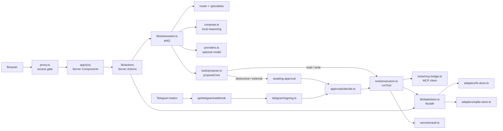

# Architecture

OmniOS is a local-first Next.js app that keeps several companies and a personal life in one workspace behind one Executive Assistant. The assistant grounds its answers in stored records, and any tool call tiered `destructive` or `external` waits for a recorded human decision. Model-provider requests are not tool calls: once a provider key is configured, prompts and the context derived from records are sent to that provider (`lib/ai/providers.ts`). With no provider configured the assistant reasons locally (`lib/ai/compose.ts`).

Why the repository is shaped this way: [`DECISIONS.md`](./DECISIONS.md). The invariants that must not be broken: [`../CLAUDE.md`](../CLAUDE.md).

## Request flow

## Modules

| Module | Responsibility | Key files |
| --- | --- | --- |
| Access gate | Session-cookie check in front of pages, Server Actions and APIs | `proxy.ts`, `lib/auth/paths.ts`, `lib/auth/token.ts` |
| Routes and UI | Server Components by default; client code only for interaction | `app/(os)/`, `components/` |
| Domain | Types and the scope boundary; no I/O | `lib/domain/` |
| Capabilities | One registry drives navigation, HQ generation and specialist routing | `lib/capabilities/registry.ts` |
| Generation | Seeded, deterministic HQ and life plans | `lib/generation/` |
| Assistant | Single entry point, declarative routing, grounded local composition, optional model | `lib/ai/assistant.ts`, `router.ts`, `specialists.ts`, `compose.ts`, `providers.ts` |
| Tools and gate | Tool catalogue with risk tiers, proposing, running | `lib/ai/tools/registry.ts`, `propose.ts`, `executors.ts` (gate and table), `executors/` (executor groups), `lib/domain/tools.ts` |
| Approvals | Persists who decided, before the call runs | `lib/approvals/decide.ts`, `lib/actions/tools.ts` |
| Persistence | Store facade over a port with two adapters | `lib/data/store.ts`, `store-port.ts`, `adapters/` |
| Cross-space view | The only module that reads across scopes | `lib/data/aggregate.ts` (facade), `lib/data/aggregate/` |
| Vault | AES-256-GCM secrets store | `lib/secrets/vault.ts` |
| MCP | Outbound client, bridged to tools; separate read-only server | `lib/mcp/client.ts`, `lib/mcp/serve.ts`, `lib/ai/tools/mcp-bridge.ts` |
| Telegram | Approval delivery and signed callbacks | `lib/telegram/`, `app/api/telegram/webhook/route.ts` |
| Ops | Mac runbook: server, tunnel, heartbeat, backup | `ops/` |

## Boundaries and gates

- **Authentication.** Opt-in: with `OMNIOS_ACCESS_KEY` unset the app has no auth; with it set, `proxy.ts` requires a signed session cookie for everything except the paths listed in `lib/auth/paths.ts`. Those exempt routes (`/api/telegram/webhook`, `/api/health`) authenticate themselves.
- **Response headers.** `next.config.mjs` sends `nosniff`, frame denial, a referrer policy and a permissions policy on every route; `tests/security-headers.test.ts` pins them.
- **Human approval.** `requiresApproval` in `lib/domain/tools.ts` returns true for every risk tier except `read` and `write` (and for `write` when `confirmWrites` is set). `proposeCore` applies it; `runTool` refuses gated calls. Decisions are written by `lib/approvals/decide.ts` before the call runs. Pinned by `tests/tools.test.ts`, `tests/grants.test.ts` and `tests/boundaries.test.ts`. The executor groups under `lib/ai/tools/executors/` are imported only by the facade `lib/ai/tools/executors.ts`, which `tests/boundaries.test.ts` pins.
- **Scope isolation.** Every store read names a scope. `tests/boundaries.test.ts` fails if anything under `lib/ai/` imports `lib/data/aggregate`, and ESLint forbids importing `lib/data/adapters/*` outside the facade (`eslint.config.mjs`).
- **Telegram decisions.** The webhook checks a shared secret, then an HMAC bound to the chat, then the same approval path as the in-app buttons (`app/api/telegram/webhook/route.ts`, `lib/telegram/signing.ts`).
- **External calls.** Outward capability arrives as an MCP server the founder connects; it passes the same gate. Requests to a configured model provider are the exception to per-call approval (`lib/ai/providers.ts`). Provider keys are read from the vault or the environment (`.env.example`).
- **MCP server.** `lib/mcp/serve.ts` exposes read-only tools, each requiring a scope.
