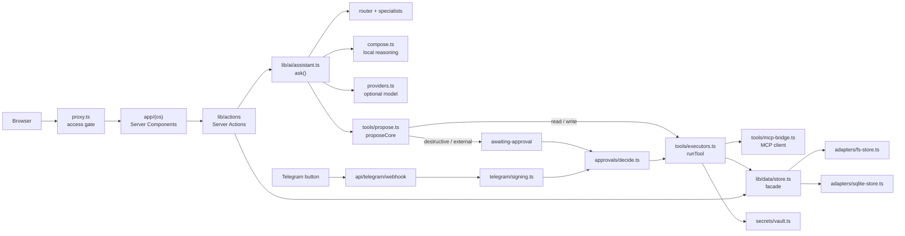
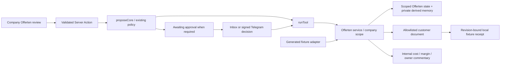

# Architecture

OmniOS is a local-first Next.js app that keeps several companies and a personal life in one workspace behind one Executive Assistant. The assistant grounds its answers in stored records, and any tool call tiered `destructive` or `external` waits for a recorded human decision. Model-provider requests are not tool calls: once a provider key is configured, prompts and the context derived from records are sent to that provider (`lib/ai/providers.ts`). With no provider configured the assistant reasons locally (`lib/ai/compose.ts`).

Why the repository is shaped this way: [`DECISIONS.md`](./DECISIONS.md). The invariants that must not be broken: [`../CLAUDE.md`](../CLAUDE.md).

## Request flow

## Modules

| Module | Responsibility | Key files |
| --- | --- | --- |
| Access gate | Session-cookie check in front of pages, Server Actions and APIs | `proxy.ts`, `lib/auth/paths.ts`, `lib/auth/token.ts` |
| Routes and UI | Server Components by default; client code only for interaction | `app/(os)/`, `components/` |
| Domain | Types and the scope boundary; no I/O | `lib/domain/` |
| Capabilities | One registry drives navigation, HQ generation and specialist routing | `lib/capabilities/registry.ts` |
| Generation | Seeded, deterministic HQ and life plans | `lib/generation/` |
| Assistant | Single entry point, declarative routing, grounded local composition, optional model | `lib/ai/assistant.ts`, `router.ts`, `specialists.ts`, `compose.ts`, `providers.ts` |
| Tools and gate | Tool catalogue with risk tiers, proposing, running | `lib/ai/tools/registry.ts`, `propose.ts`, `executors.ts`, `lib/domain/tools.ts` |
| Approvals | Persists who decided, before the call runs | `lib/approvals/decide.ts`, `lib/actions/tools.ts` |
| Persistence | Store facade over a port with two adapters | `lib/data/store.ts`, `store-port.ts`, `adapters/` |
| Cross-space view | The only module that reads across scopes | `lib/data/aggregate.ts` |
| Vault | AES-256-GCM secrets store | `lib/secrets/vault.ts` |
| MCP | Outbound client, bridged to tools; separate read-only server | `lib/mcp/client.ts`, `lib/mcp/serve.ts`, `lib/ai/tools/mcp-bridge.ts` |
| Telegram | Approval delivery and signed callbacks | `lib/telegram/`, `app/api/telegram/webhook/route.ts` |
| Ops | Mac runbook: server, tunnel, heartbeat, backup | `ops/` |
| Offerten | Company-only fixture ingest, structured quote/customer/internal schemas, evidence-led prices, private memory, revision-checked edits and local receipts | `lib/offerten/`, `components/offerten/`, `lib/actions/offerten.ts` |

## Boundaries and gates

- **Authentication.** Opt-in: with `OMNIOS_ACCESS_KEY` unset the app has no auth; with it set, `proxy.ts` requires a signed session cookie for everything except the paths listed in `lib/auth/paths.ts`. Those exempt routes (`/api/telegram/webhook`, `/api/health`) authenticate themselves.
- **Human approval.** `requiresApproval` in `lib/domain/tools.ts` returns true for every risk tier except `read` and `write` (and for `write` when `confirmWrites` is set). `proposeCore` applies it; `runTool` refuses gated calls. Decisions are written by `lib/approvals/decide.ts` before the call runs. Pinned by `tests/tools.test.ts`, `tests/grants.test.ts` and `tests/boundaries.test.ts`.
- **Scope isolation.** Every store read names a scope. `tests/boundaries.test.ts` fails if anything under `lib/ai/` imports `lib/data/aggregate`, and ESLint forbids importing `lib/data/adapters/*` outside the facade (`eslint.config.mjs`).
- **Telegram decisions.** The webhook checks a shared secret, then an HMAC bound to the chat, then the same approval path as the in-app buttons (`app/api/telegram/webhook/route.ts`, `lib/telegram/signing.ts`).
- **External calls.** Outward capability arrives as an MCP server the founder connects; it passes the same gate. Requests to a configured model provider are the exception to per-call approval (`lib/ai/providers.ts`). Provider keys are read from the vault or the environment (`.env.example`).
- **MCP server.** `lib/mcp/serve.ts` exposes read-only tools, each requiring a scope.

## Offerten boundary

Offerten is registered once, with a company-only panel and specialist. The
existing dynamic company capability route renders its review panel; OS-level
capability pages do not aggregate private quote sheets. Browser mutations first
resolve an active company from the workspace, then use `proposeCore`. Fixture
ingest and send are `external`, deletion is `destructive`, comparison is `read`,
and draft/edit/memory/export are `write` (including `confirmWrites`).

The scoped Offerten collection is not a generic CRUD/search or MCP collection.
Private Offerten memory and related tool records are excluded from generic
assistant/provider context and generic recall; its own retrieval is local-only.
There is no model invocation or network connection in fixture ingestion/drafting.
Ingestion can validate configured vault references inside its executor-facing
path, but no resolved plaintext is retained or passed to the unauthenticated
fixture adapter. Customer documents are built through a strict
allowlist schema, never by redacting an internal sheet.

The assistant on the Offerten surface, or a request routed to its specialist,
stays local and redirects private intake to the review UI. It does not hand that
turn to a provider, slash-command execution, action loop or query embedding.
Private transcripts and runs are marked and excluded from generic histories.

Edits require `expectedRevision`; sends require an exact `quoteId` and
`revision`, plus the already-persisted decision for that call. A stale package
fails rather than approving a changed document. Export tooling records only a
static summary; an explicit scoped readback downloads the complete private
bundle locally after an executed export. Deletion covers derived private
memory and payload copies, while retaining decision metadata; downloaded files
and backups remain the operator's responsibility.

See [`offerten/DESIGN.md`](./offerten/DESIGN.md) for the actual Zod shapes and
[`offerten/TENANCY.md`](./offerten/TENANCY.md) before any pilot access.
