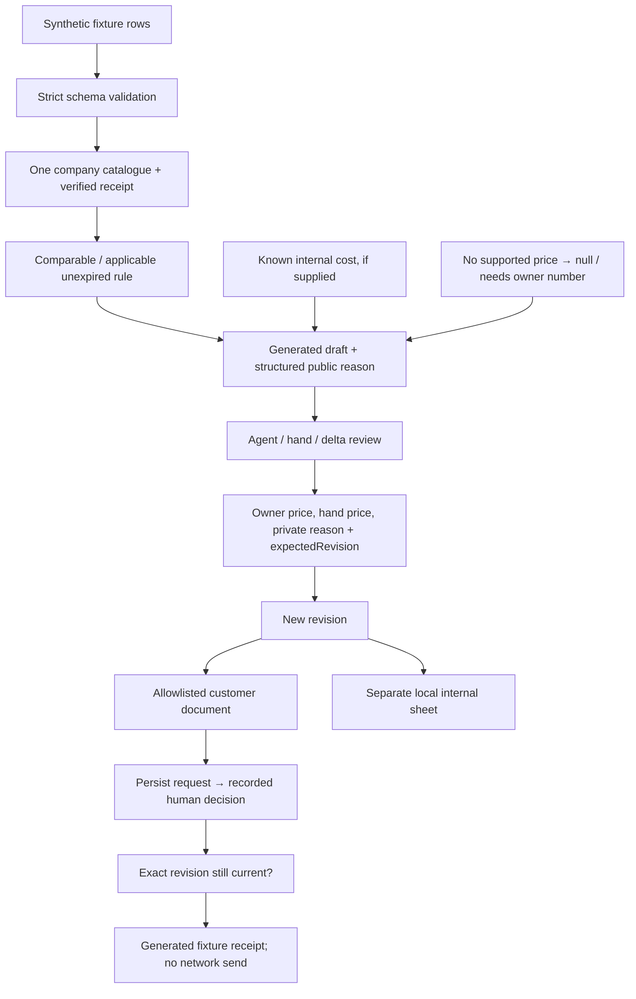

# Offerten design — fixture delivery

Status: company-only, generated local workflow. There is no live ERP transport,
external customer send, real-data import or fine-tuning. The runtime schemas in
`lib/offerten/schema.ts` are authoritative.

## Schema map

| Zod schema / record | Fields and boundary |
| --- | --- |
| `ConnectorConfigSchema` | `host`, `type` (`fixture`, `postgres`, `mysql`, `mssql`, `sqlite`), identifier-keyed `mapping`, `secrets` containing only `{{secret:NAME}}` placeholders. Declared SQL types are configuration vocabulary, not implemented connections. |
| `QuoteHeaderSchema` | `customer`, `site`, `date`, `currency`, `vatRate`, `language`, `status`; unknown source fields remain nullable, fixture defaults are not observed company policy. |
| `PositionInputSchema` | `id?`, `description`, nullable `quantity`, `unit`, `unitPrice?`, `cost`, `handPrice`, `sourceQuoteId`; money is nonnegative integer minor units, quantity must be positive when known. |
| `PriceReasonSchema` | `code`, safe public `text`, nullable `source` (`kind`, `id`, optional `positionId`), `appliesBecause`, nullable `nearestComparableDelta`; owner free text belongs only to internal commentary. |
| `OffertenPositionSchema` | Position identity, description, quantity/unit, proposed and reviewed unit prices, independent `handPrice`, reason, source quote. Missing prices are `null`. |
| `CustomerDocumentSchema` | `generated`, quote id/revision, header, allowlisted positions with line totals and safe reasons, subtotal/VAT/total. No cost, margin, hand calculation, private rule fact or owner commentary field. |
| `InternalSheetSchema` | `generated`, per-position unit `cost`/`margin`, `lineCost`/`lineRevenue`/`lineMargin`, `commentary`, `notes`, `totalCost`/`totalRevenue`/`totalMargin`. Separate from the customer schema. |
| `OffertenQuoteSchema` | Header/positions/internal, `id`, `revision`, `generated`, timestamps, separate `documents.customer` / `documents.internal`, `sentRevision`, nullable owner-stated `manualBaselineMinutes` and internally clocked `intakeMinutes`. |
| `OffertenEditSchema` | Required `expectedRevision`, optional partial header, manual baseline and position edits (`unitPrice`, `quantity`, `handPrice`, `reason`). Stale edits fail; elapsed time is not editable. |
| `IngestReceiptSchema` | Generated fixture quote/position counts, stable SHA-256, adapter, timestamp, verified readback. Counts describe synthetic records, not productivity. |
| `OffertenRuleSchema` | Tagged fact, establishment/expiry, source, optional exact pricing applicability; private local memory, never customer prose. |

`OffertenState` groups one company's connector, catalogue, current quotes,
ingest/send receipts, rules, audit trail, owner decision observations, nullable
metrics, cost masters, memory retention days and derived memory hash. Each send
receipt includes the immutable approved customer document and its hash.
`OffertenExport` contains that complete state, derived Markdown, tagged private
scoped records (including related transcript/run/index/feedback/tool history)
and its SHA-256. Do not pass connector state to client page props. Full exports are
intentionally private local artifacts.

## Price and document flow

Prices and costs are **per-unit minor amounts**. Each line is
`round(quantity × unitPrice)`; aggregate inputs must all exist before a total is
claimed. Unit margin is `unitPrice − cost`; overall margin also needs every
quantity and cost. Deviation is agent minus independent hand price, never a
comparison to a copied agent number. VAT-inclusive totals require a known rate;
blank is not zero. Currency defaults to CHF and language to German only where
explicitly chosen for the fixture workflow. Confirm real currency, language,
VAT and cash/invoice rounding before a pilot; the fixture's integer-minor-unit
rounding is not a tax/legal policy.

Owner-review metrics come from persisted decisions, not imported fixture
counts. Acceptance is a ratio internally and displayed as a percentage only
after at least three observations; it is **owner approval, not customer
acceptance**. Relative price deviation compares the independent
`handPrice` with the agent price. Original `proposedUnitPrice` versus approved
final corrections are recorded separately and are not an independent hand
calculation. Fixture time saved needs an explicit owner-stated manual baseline
and internally clocked draft-creation-to-approval elapsed minutes; client/model
elapsed values are not accepted. Rejected decisions do not contribute elapsed
time savings. It stays absent without both inputs and is not production-pilot
productivity evidence. Generated pricing rules expire after the
configured retention interval (default 365 days); that is an engineering
default, not an approved legal retention policy.

The hand-deviation distribution is absent until at least three finite,
independent line comparisons exist. Its `n`, median and P90 are generated
fixture-workflow evidence, not a production accuracy benchmark.

## Integration seam

Registry: `lib/capabilities/registry.ts`; company-only specialist:
`lib/ai/specialists.ts`; panel: `components/offerten/`; actions:
`lib/actions/offerten.ts`. No new route, assistant, approval inbox or connector
framework is introduced. Tool risk is selected by effect:

| Tool | Tier |
| --- | --- |
| `offerten.ingest`, `offerten.send` | external; always recorded approval |
| `offerten.draft`, `offerten.edit`, `offerten.update_memory`, `offerten.export` | write; obey `confirmWrites` |
| `offerten.compare` | read |
| `offerten.delete` | destructive; always recorded approval |

All UI mutations go through `proposeCore`. Export tool history contains a static
summary, not the bundle. Customer send packages never contain the internal sheet.
The existing inbox and signed Telegram callback are two doors to one gate.
The draft form supports 1–20 positions; service schemas support up to 200.
Structured draft/edit tool payloads have an explicit 512,000-character ceiling
and overlong JSON is rejected intact, never truncated into a different request.
The internal review names the actual source quote id for audit; customer reasons
use only safe opaque references.
